<h1 align="center">Nishritha Damera</h1>

<p align="center">
  <b>AI products should earn trust <i>before</i> anyone depends on them.<br>That's the part I work on.</b>
</p>

<p align="center">
  QA Automation Engineer · Hyderabad · testing GenAI and agentic AI used in 20+ countries<br>
  <a href="https://nishritha.is-a.dev/">Portfolio</a> ·
  <a href="https://www.linkedin.com/in/nishrithadamera/">LinkedIn</a> ·
  <a href="mailto:nishrithadamera@gmail.com">Email</a>
</p>

<p align="center">
  🟢 <b>Open to work</b>: QA Automation Engineer and SDET roles. <a href="mailto:nishrithadamera@gmail.com">Let's talk.</a>
</p>

<p align="center">
  
</p>

## 🐞 Bug reports I'm glad I filed

<details>
<summary><b>BUG-01</b> · Reports crawled because Service Bus never scaled out</summary>
<br>

```diff
- small report   15–20 min
+ small report   ~3 min
- large report   ~30 min
+ large report   5–7 min
```
Found while testing report generation across services. The autoscaling fix did the rest.
</details>

<details>
<summary><b>BUG-02</b> · One report cost $40–50 to generate, and nobody knew why</summary>
<br>

```diff
- $40–50 of LLM spend per large report, cause unknown
+ traced to a single MCP tool by watching OpenAI, Anthropic, Gemini and Serper usage side by side
```
Since then, token spend gets reviewed next to test results. For an LLM feature, cost is a quality signal.
</details>

<details>
<summary><b>BUG-03</b> · Status went stale, but only for some users, on slow networks</summary>
<br>

```diff
- WebSocket status out of sync across tabs and users
+ reproduced with multi-tab, multi-user, slow-network runs and logged with video, logs and exact steps
```
</details>

<details>
<summary><b>BUG-04</b> · Press the button twice, get the job twice</summary>
<br>

```diff
- double submit on an AI deep-research feature, spreading into many modules
+ caught in exploratory testing before users found it
```
</details>

## 🧱 Where a release gets checked

<p align="center">
  
</p>

## 💼 Work experience

**QA Automation Engineer · Infinite Possibilities** · Apr 2025 – present

- Test GenAI, LLM, voice AI and agentic AI web apps end to end (UI, APIs, databases and cloud pipelines) for products used in 20+ countries.
- Built a Playwright (Python) regression framework with Page Object Model, pytest and Allure, running headless in CI, and raised smoke coverage by ~40%.
- Cut manual testing effort by 30% with regression automation.
- Own QA and production releases: branch cuts, environment variables, post-deployment checks and production smoke tests.
- Check AI output for accuracy, hallucinations and consistency across reruns, and monitor LLM usage and cost.
- Set up 5 tenants, verified tenant data isolation and reconciled UI figures against the database.
- Build and test frontend features in TypeScript.
- Mentor and onboard junior QA engineers.

**QA Automation Intern · Infinite Possibilities** · Jan – Mar 2025

- Designed smoke and regression test cases for fintech features, built Playwright (Python) suites and logged defects in Jira.

## 🧪 Tech stack

| Area | Stack |
|---|---|
| Testing and automation | Playwright · pytest · Selenium · Allure · Page Object Model |
| API and performance | REST · Postman · JMeter |
| Languages | Python · TypeScript · JavaScript · SQL |
| Databases | PostgreSQL · MySQL · MongoDB |
| CI/CD | GitHub Actions · Azure DevOps · Jenkins · Git |
| Cloud and monitoring | Azure (Container Apps, Function Apps, Service Bus) · AWS · Datadog |
| AI | Claude Code · Cursor · OpenAI, Anthropic and Gemini usage monitoring |

I write tests faster with Claude Code and Cursor, and read every AI-written test before I trust it.

## 📦 Side projects

| Project | What it does | Built with |
|---|---|---|
| [Sentiment analysis for job classification](https://github.com/Nishritha03/sentiment_analysis_in_job_recommendation) | Classifies job roles from user input and review sentiment | Python, NLP, scikit-learn |
| [Weather report bot](https://github.com/Nishritha03/Weather-Report-Bot) | A voice assistant that answers weather questions out loud | Python, speech recognition, pyttsx3 |
| Dataset scraping pipelines | Two public datasets on Hugging Face: [top PyPI packages](https://huggingface.co/datasets/deepklarity/top-pypi-packages) and [top Chrome extensions](https://huggingface.co/datasets/deepklarity/top_chrome_extensions) | Python, Selenium, BeautifulSoup |

<p align="center">
  <b>Hiring for QA automation or SDET?</b> I'd like to hear about it:
  <a href="mailto:nishrithadamera@gmail.com">nishrithadamera@gmail.com</a> ·
  <a href="https://www.linkedin.com/in/nishrithadamera/">LinkedIn</a>
</p>

<p align="center"><sub>Claude Certified Developer – Foundations · Claude Code in Action · AWS Cloud Practitioner</sub></p>
